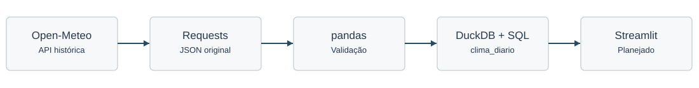
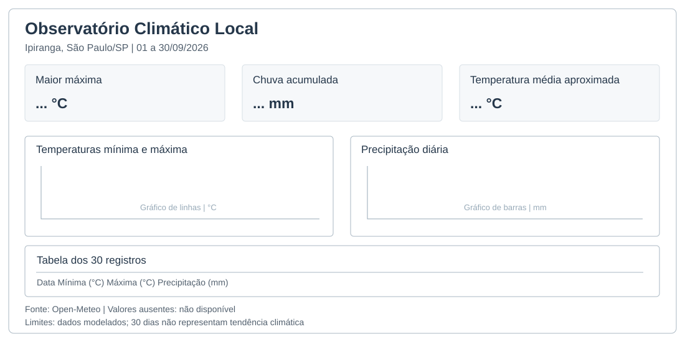

# AE2-2 | Desenho da solução

## Recorte

| Item | Definição |
| --- | --- |
| Localidade | Ipiranga, São Paulo/SP |
| Coordenadas | -23.59139, -46.60778 |
| Período | 01 a 30/09/2026, 30 dias |
| Fuso | `America/Sao_Paulo` |
| Fonte | [Open-Meteo Historical Weather API](https://open-meteo.com/en/docs/historical-weather-api) |
| Variáveis | Temperatura mínima e máxima diárias (°C); precipitação diária (mm) |
| Público | Estudantes e educadores da comunidade escolar do Ipiranga |

O recorte segue a configuração e as perguntas documentadas no README existente. Esta atividade registra o desenho técnico. A coleta, o tratamento, o DuckDB e o relatório já foram implementados; o painel em Streamlit permanece planejado.

## 1. Dicionário de dados

Tabela principal: `clima_diario`. Uma linha por data para a única localidade do recorte.

| Campo | Tipo DuckDB | Descrição | Origem | Regra |
| --- | --- | --- | --- | --- |
| `data` | DATE | Data do registro | `daily.time` | Obrigatória, de 01 a 30/09/2026, única |
| `localidade` | VARCHAR | Nome da localidade | `config.json: localidade` | Obrigatória, constante no recorte |
| `latitude` | DOUBLE | Latitude decimal | `config.json: latitude` | Obrigatória, de -90 a 90; -23.59139 |
| `longitude` | DOUBLE | Longitude decimal | `config.json: longitude` | Obrigatória, de -180 a 180; -46.60778 |
| `temperatura_min_c` | DOUBLE | Mínima diária, °C | `daily.temperature_2m_min` | Aceita NULL; finita; faixa de triagem -60 a 65 °C; ≤ máxima quando ambas existirem |
| `temperatura_max_c` | DOUBLE | Máxima diária, °C | `daily.temperature_2m_max` | Aceita NULL; finita; faixa de triagem -60 a 65 °C; ≥ mínima quando ambas existirem |
| `precipitacao_mm` | DOUBLE | Precipitação diária, mm | `daily.precipitation_sum` | Aceita NULL; finita; não negativa |

A faixa térmica é uma regra técnica de triagem já utilizada no código, não um limite climatológico validado especificamente para o Ipiranga.

## 2. Modelo lógico

```sql
CREATE TABLE clima_diario (
    data DATE PRIMARY KEY,
    localidade VARCHAR NOT NULL,
    latitude DOUBLE NOT NULL,
    longitude DOUBLE NOT NULL,
    temperatura_min_c DOUBLE,
    temperatura_max_c DOUBLE,
    precipitacao_mm DOUBLE
);
```

A chave primária `data` impede duplicidade no escopo de uma localidade. A carga já utiliza `ON CONFLICT (data) DO UPDATE`, permitindo reexecução idempotente. Não há chaves estrangeiras nem relacionamentos nesta versão. Para abranger outras localidades, será necessário usar uma chave composta com identificador estável de localidade e data.



## 3. Plano de qualidade

| Checagem | Campos | Regra objetiva | Tratamento |
| --- | --- | --- | --- |
| Estrutura | `daily`, `daily_units` | Objeto diário e séries esperadas presentes | Bloquear carga e revisar resposta |
| Obrigatoriedade | `data`, `localidade`, `latitude`, `longitude` | Não nulos; coordenadas válidas | Corrigir configuração ou rejeitar |
| Datas | `data` | ISO 8601 e dentro do período | Rejeitar registros inválidos |
| Cobertura | `data` | Exatamente 30 dias consecutivos | Bloquear e investigar ausência |
| Duplicidade | `data` | Nenhuma data duplicada | Rejeitar antes da carga |
| Unidades | Séries e `timezone` | °C, mm e America/Sao_Paulo | Bloquear incompatibilidades |
| Tipos | Variáveis meteorológicas | Numéricos finitos ou NULL | Rejeitar texto e infinito |
| Temperaturas | `temperatura_min_c`, `temperatura_max_c` | Mínima ≤ máxima; triagem -60 a 65 °C | Bloquear inconsistência; revisar extremos |
| Precipitação | `precipitacao_mm` | Se presente, ≥ 0 | Rejeitar negativos |
| Ausências | Três variáveis | Contar NULL por variável e por KPI | Não imputar zero; exibir cobertura |

NULL indica dado ausente; zero de precipitação indica valor informado igual a zero. O total com dados incompletos deve ser identificado como parcial.

## 4. Plano de análise

| Pergunta | Campos | Cálculo | KPI e visual | Uso |
| --- | --- | --- | --- | --- |
| Qual foi a maior temperatura máxima e quando ocorreu? | `data`, `temperatura_max_c` | `MAX(temperatura_max_c)`; recuperar todas as datas empatadas | Maior máxima (°C); gráfico de temperaturas | Identificar picos do período |
| Quanto choveu e em quantos dias houve precipitação? | `data`, `precipitacao_mm` | `SUM(precipitacao_mm)`; `COUNT` dos valores > 0 e dos não nulos | Chuva acumulada (mm); barras diárias | Debater volume e frequência |
| Qual foi a temperatura média diária aproximada? | `temperatura_min_c`, `temperatura_max_c` | `AVG((temperatura_min_c + temperatura_max_c)/2)` | Média aproximada (°C); gráfico de temperaturas | Comparar dias no recorte |

### Indicadores e ausências

| KPI | Definição e cálculo | Unidade | Ausências | Interpretação |
| --- | --- | --- | --- | --- |
| Maior máxima | Maior máxima diária válida, `MAX(temperatura_max_c)` | °C | Ignorar NULL; sem observações válidas, exibir não disponível | Pico do intervalo, não tendência |
| Chuva acumulada | Soma das precipitações diárias informadas | mm | NULL não é zero; sinalizar soma parcial se faltar dia; todos NULL: não disponível | Volume do período com cobertura declarada |
| Média aproximada | Média das semissomas diárias `AVG((min + max)/2)` | °C | Considerar somente pares válidos; sem pares, não disponível | Aproximação, não média horária |

Os visuais previstos são um gráfico de linhas para mínima e máxima, um gráfico de barras para precipitação diária e uma tabela com os 30 registros. Nenhum resultado futuro é presumido nesta especificação.

## 5. Wireframe



O painel deverá mostrar título, localidade, período, três KPIs, dois gráficos, tabela, fonte, unidades e limitações. Filtros não são necessários para um único local e período fixo.

## 6. Comunicação extensionista

O público beneficiário utilizará os gráficos para interpretar séries meteorológicas, distinguir variações diárias e discutir registros de chuva e temperatura. A apresentação deverá explicar as unidades, os dados faltantes e o que cada indicador efetivamente mede.

A Open-Meteo fornece dados modelados/de reanálise, não leituras comprovadas de estação meteorológica no Ipiranga. Trinta dias não permitem concluir tendências climáticas de longo prazo, nem os registros históricos substituem previsão ou alerta meteorológico para atividades futuras.

## Fontes

- [Open-Meteo: API histórica](https://open-meteo.com/en/docs/historical-weather-api)
- [DuckDB: documentação](https://duckdb.org/docs/stable/)
- [Streamlit: referência](https://docs.streamlit.io/develop/api-reference)
